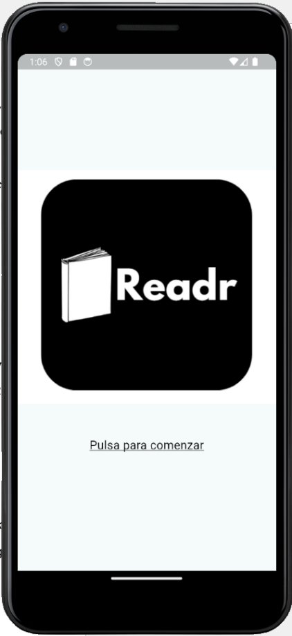
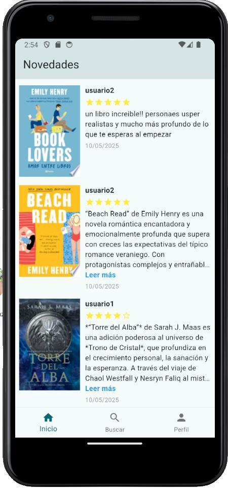
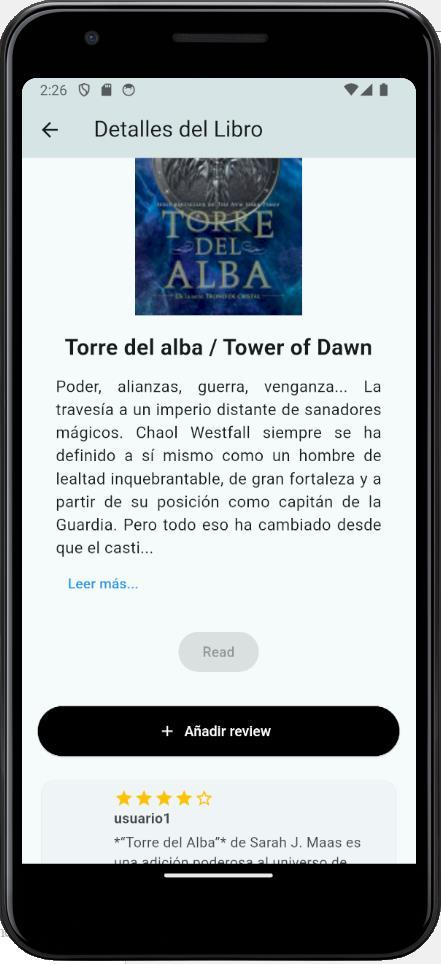
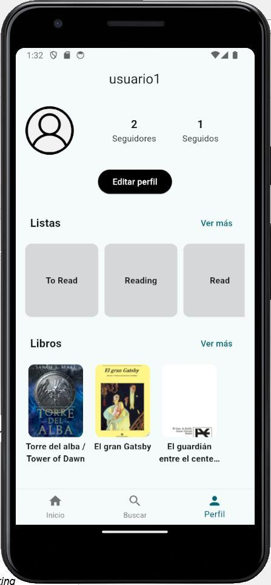
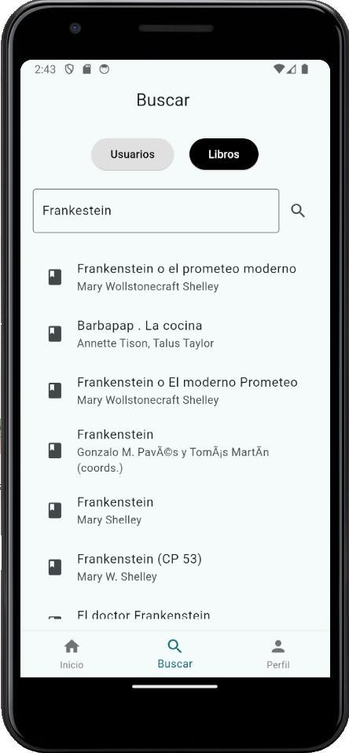
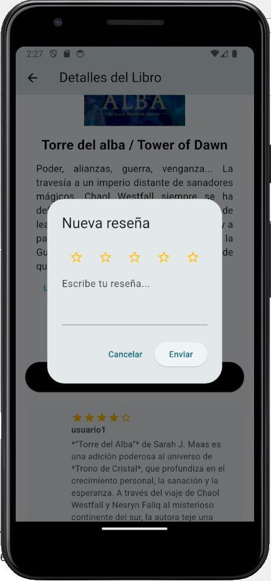
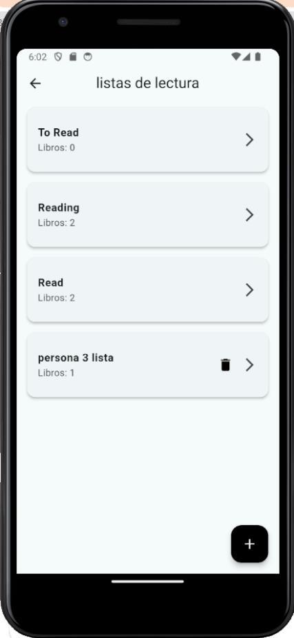
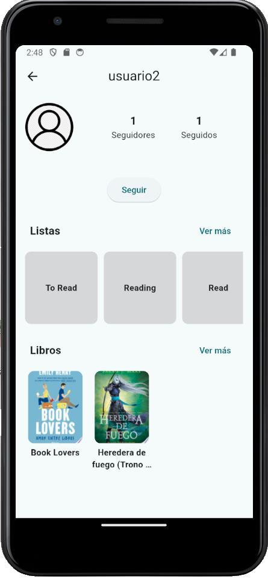
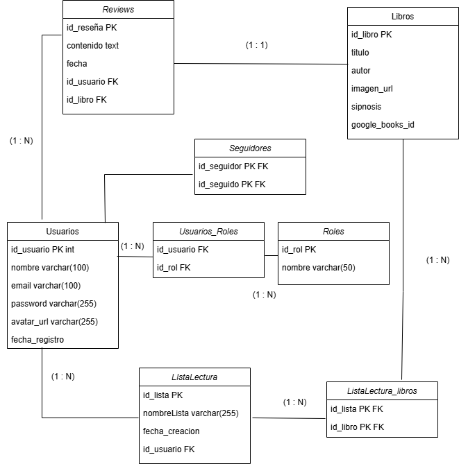

# Readr

**Readr** is a social reading app for mobile. Readers can organise their books into lists, write reviews with a star rating, follow other readers and see what they are reading in a chronological feed.

It is a full-stack project: a **Flutter** mobile client and a **Spring Boot** REST API backed by **MySQL**, with book data from the **Google Books API**.

| Welcome | Feed | Book detail | Profile |
|---|---|---|---|
|  |  |  |  |

## Context

Readr is my **Final Degree Project (TFG)** for the Higher Vocational Training degree in **Multiplatform Application Development** (*CFGS Desarrollo de Aplicaciones Multiplataforma*) at **EEP iGroup**. It was presented in June 2025.

The idea came from my own experience as a reader: existing tools such as Goodreads or The StoryGraph are good at tracking books, but their social side is limited or dated. Readr combines both: a reading tracker and a small social network built around books.

One deliberate design decision: Readr has **no likes and no comments on reviews**. The goal is a calmer space where reading is the point of connection, not a way to measure popularity.

The project objectives were to:

1. Build a working mobile app to register, organise and follow reading.
2. Add social features (reviews and a feed) to connect readers.
3. Design a simple, attractive user experience.
4. Learn and apply Flutter for the front end and Spring Boot with a relational database for the back end.

The code, comments and user interface are in Spanish.

## Features

**Account**
- Sign up and log in with email and password, with form validation (invalid email, short password, wrong credentials, email already registered).
- Server-side sessions, so the user stays logged in while using the app. Log out from the profile.

**Books**
- Search books by title through the Google Books API.
- Book detail screen with cover, author and synopsis.
- Books are saved to the local database the first time a user adds them.

**Reading lists**
- Three default lists for every user: *To Read*, *Reading* and *Read*.
- Create custom lists, add and remove books, move a book from one list to another, and delete lists.

**Reviews**
- Write a review with a 1–5 star rating from the book detail screen.
- See all the reviews of a book.
- The API also supports editing and deleting reviews, but the app does not expose these actions yet.

**Social**
- Search users by name and visit their profile, lists and reviews.
- Follow and unfollow other readers. Followers and following lists.
- **Feed** ("Novedades"): the reviews written by the people you follow, with cover, rating, text and date.

**Profile**
- Your lists, books and reviews in one place.
- Edit your name and upload a profile picture from the gallery.

| Log in | Search books | New review | Reading lists | Another reader's profile |
|---|---|---|---|---|
|  |  |  |  |  |

*Screenshots taken on the Android emulator with test accounts.*

### Not implemented

These were planned but are **not** part of the current version: a reading progress bar, replies to reviews, private messages, book recommendations, and an administrator interface. The role model (`User` / `Admin`) exists in the database and backend, but the app only exposes the user role.

## Technologies

| Layer | Technology | Role |
|---|---|---|
| Mobile app | **Flutter** / **Dart** | Cross-platform UI from a single code base |
| | `dio`, `cookie_jar`, `dio_cookie_manager` | HTTP client that stores the session cookie and sends it with every request |
| | `http` | Additional HTTP requests |
| | `shared_preferences` | Stores the logged-in user's id on the device |
| | `image_picker` | Picks a profile picture from the gallery |
| | `intl` | Date formatting |
| Backend | **Java 17**, **Spring Boot 3.3** | REST API |
| | Spring Web | Controllers and JSON endpoints |
| | Spring Data JPA (Hibernate) | Object-relational mapping and repositories |
| | Spring Security Crypto (`BCryptPasswordEncoder`) | Password hashing |
| | `HttpSession` (Jakarta Servlet) | Session-based authentication with the `JSESSIONID` cookie |
| | Maven (wrapper included) | Build and dependency management |
| Database | **MySQL 8** | Relational storage |
| External API | **Google Books API** | Book search, covers and metadata |

## Architecture

```text
┌──────────────────────┐   HTTP + JSON    ┌────────────────────────────────────────┐
│  Flutter app (Dart)  │   JSESSIONID     │        Spring Boot REST API            │
│                      │ ───────────────► │                                        │
│  screens/  models/   │                  │  controllers → services → repositories │
│  core/dio_client     │ ◄─────────────── │        (DTOs)             (JPA)        │
└──────────────────────┘                  └───────────┬──────────────────┬─────────┘
                                                      │                  │
                                                      ▼                  ▼
                                               ┌────────────┐   ┌──────────────────┐
                                               │   MySQL    │   │ Google Books API │
                                               └────────────┘   └──────────────────┘
```

### Backend

The backend follows a layered structure:

- **Controllers** expose the REST endpoints and check the session.
- **Services** contain the business logic.
- **Repositories** (`JpaRepository`) access the database without hand-written SQL, with a few custom queries.
- **Entities** map to tables, and **DTOs** define which data is sent to the client instead of returning whole entities.

| Base path | Controller | Purpose |
|---|---|---|
| `/auth` | `AuthenticationController` | Register, log in, log out |
| `/api/usuarios` | `UsuarioController` | Profiles, search by name, follow / unfollow, followers, edit profile and avatar |
| `/api/libros` | `LibroController` | Search in Google Books, save a book, get a book |
| `/api/listas-lectura` | `ListaLecturaController` | Default and custom lists, add and remove books |
| `/api/resenas` | `ReviewsController` | Create, read, update and delete reviews, and the feed |

**Authentication.** Passwords are hashed with BCrypt before they are stored. On login the server creates an HTTP session and returns a `JSESSIONID` cookie. Protected endpoints read the user from the session. Sessions expire after 220 minutes.

**Profile pictures.** Images are sent as multipart files, saved to the `uploads/` folder with a UUID in the file name to avoid collisions, and served as static files under `/uploads/**`.

### Data model



Main entities: `Usuario`, `Rol`, `Libro`, `ListaLectura` and `Reviews`. Users and roles, lists and books, and followers are many-to-many relationships with join tables. The schema is created and updated automatically by Hibernate (`ddl-auto=update`).

### Mobile app

- Each screen is a widget in `lib/screens/`. State is handled with `StatefulWidget` and `setState`, and `FutureBuilder` shows a loading indicator while data arrives from the API.
- `lib/core/dio_client.dart` provides a single shared `Dio` instance with a persistent cookie jar, so the session cookie is saved and reused automatically.
- `lib/models/` contains the classes that parse the JSON returned by the API.
- Navigation uses a bottom bar with three sections: *Inicio* (feed), *Buscar* (search) and *Perfil* (profile).

### Challenges solved during development

- **Session cookies on mobile.** With the `http` package the `JSESSIONID` cookie was not kept between requests, so the user was logged out. Switching to `dio` with a cookie jar interceptor fixed it.
- **Infinite JSON recursion.** Bidirectional JPA relationships (for example lists ↔ books) caused endless loops when converted to JSON. This was solved with `@JsonManagedReference`, `@JsonBackReference`, `@JsonIgnore` and DTOs.
- **Google Books integration.** The API response is mapped with dedicated DTO classes, and covers are loaded directly from their URLs instead of being stored.

## Project Structure

```text
.
├── front/readr_app/             # Flutter mobile app
│   ├── lib/
│   │   ├── main.dart, app.dart  # Entry point and app configuration
│   │   ├── core/                # Shared HTTP client (Dio + cookies)
│   │   ├── models/              # Libro, Lista, Review, Usuario
│   │   └── screens/             # 14 screens (auth, feed, search, book, lists, profiles...)
│   ├── assets/                  # Logo and default avatar
│   └── android/ ios/ web/ ...   # Platform projects generated by Flutter
├── spring/App-TFG/              # Spring Boot backend
│   ├── src/main/java/com/example/App_TFG/
│   │   ├── controllers/         # REST endpoints
│   │   ├── services/            # Business logic
│   │   ├── repositories/        # Spring Data JPA repositories
│   │   ├── entidades/           # JPA entities
│   │   └── dto/                 # Data transfer objects
│   ├── src/main/resources/application.properties
│   ├── uploads/                 # Profile pictures saved at runtime (not versioned)
│   ├── .env.example             # Example environment variables
│   └── pom.xml
└── docs/                        # Screenshots and data model diagram
```

## Getting Started

> These instructions are based on the project configuration. They have not been re-tested on a clean machine for this publication.

### Prerequisites

- **Java 17** (JDK)
- **MySQL 8**
- **Flutter** 3.27 or newer (Dart SDK 3.6.1 or newer)
- **Android Studio** with an Android emulator
- A **Google Books API key** ([Google Cloud Console](https://console.cloud.google.com/) → APIs & Services → Credentials)

### 1. Clone the repository

```bash
git clone https://github.com/beatrizestfr/readr-app.git
cd readr-app
```

### 2. Create the database

In MySQL, create an empty database. The tables are created automatically on first start.

```sql
CREATE DATABASE app_tfg;
```

### 3. Configuration

No secrets are stored in the repository. The backend reads them from **environment variables**:

| Variable | Description | Default |
|---|---|---|
| `DB_USERNAME` | MySQL user | `root` |
| `DB_PASSWORD` | MySQL password | none (required) |
| `GOOGLE_BOOKS_API_KEY` | Google Books API key | none (required) |

[`spring/App-TFG/.env.example`](spring/App-TFG/.env.example) lists them with placeholder values. Spring Boot does not load `.env` files by itself, so set the variables in your terminal or in your IDE's run configuration.

Windows (PowerShell):

```powershell
$env:DB_PASSWORD = "your-mysql-password"
$env:GOOGLE_BOOKS_API_KEY = "your-api-key"
```

macOS / Linux:

```bash
export DB_PASSWORD="your-mysql-password"
export GOOGLE_BOOKS_API_KEY="your-api-key"
```

The database URL (`jdbc:mysql://localhost:3306/app_tfg`) and the server port (`8080`) can be changed in `application.properties`.

### 4. Run the backend

From the same terminal where the variables are set.

Windows:

```powershell
cd spring/App-TFG
.\mvnw.cmd spring-boot:run
```

macOS / Linux:

```bash
cd spring/App-TFG
./mvnw spring-boot:run
```

The API starts on `http://localhost:8080`.

### 5. Run the mobile app

Start an **Android emulator**, then:

```bash
cd front/readr_app
flutter pub get
flutter run
```

The app calls the API at `http://10.0.2.2:8080`, the address the Android emulator uses to reach `localhost` on the host machine. To run it on a physical device or another platform, that address has to be changed in the screens under `lib/screens/` and in `UsuarioService.java` (avatar URLs).

## Testing

Testing was done **manually** on the Android emulator, covering the main flows and the error cases of the registration and login forms (invalid email, short password, wrong credentials and an email that is already registered).

Automated tests are minimal:

- **Backend:** one Spring Boot context test (`./mvnw test`). It needs the database and the environment variables to be available.
- **App:** `test/widget_test.dart` is still the default Flutter template test and has not been adapted to Readr.

## Limitations and Future Improvements

**Known limitations**

- The API address is hard-coded for the Android emulator.
- No pagination or caching in the feed and searches, which would be needed with more users and data.
- Reviews can be written for a book in any list, not only for finished books.
- The administrator role has no interface.
- Security was kept basic because of the available time: sessions are not sent over HTTPS, and the backend still prints debug information (including registration data) to the console, which should be removed before any real deployment.

**Possible improvements**

- A reading progress bar for each book
- Replies to reviews and private messages between followers
- Book recommendations based on reading history and followed users
- Moderation tools for administrators
- A central configuration for the API address, and HTTPS
- Automated tests for the API and the app

## Academic Context

- **Project:** *Readr: Desarrollo de una Aplicación Móvil para Seguimiento de Lecturas y Conexión entre Lectores*
- **Author:** Beatriz Estebaranz Franco
- **Degree:** Técnico Superior en Desarrollo de Aplicaciones Multiplataforma
- **School:** EEP iGroup
- **Presented:** June 2025

Book data and covers are provided by the [Google Books API](https://developers.google.com/books). Book covers shown in the screenshots belong to their respective publishers.

## License

This repository has no license. The code is published for portfolio and educational reference. All rights reserved.
